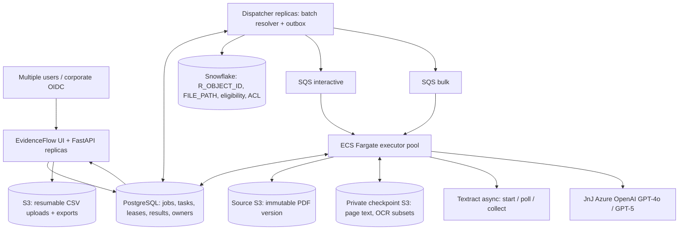

# EvidenceFlow Enterprise — architecture decision record

**Status:** enterprise-oriented runnable implementation + integration adapters; **not certified or deployed** in the JnJ environment. Cloud quotas, corporate IAM, licensing, data classification, and production load tests are required before go-live.

## Recommendation

Use **one Python codebase with three process roles** (FastAPI, dispatcher, executor), one **PostgreSQL** operational store, **two SQS Standard queues** for interactive/bulk priority, and **S3 checkpoints**. Keep the existing **Snowflake metadata source**, **S3 PDFs**, and **JnJ Azure OpenAI endpoints**. Use **PyMuPDF native text extraction** plus **AWS Textract asynchronous OCR only for unreadable pages**. Do not introduce Kubernetes, multi-agent workflows, vector databases, Spark or one workflow service instance per PDF.

## Document state versus task state

- `jobs`: user + tenant ownership, logical progress, cancellation, accepted input count.
- `documents`: one row per unique `(job_id, r_object_id)`; source and approved state, field-level evidence, model profile and terminal result.
- `stage_tasks`: durable idempotent tasks: `INGEST`, `PREPARE`, `OCR_START`, `OCR_POLL`, `FINALIZE`, `EXPORT`. The DB owns state; SQS contains **only task IDs**, not sensitive PDF content.
- `document_manifests`: expected chunk count, source S3 version, total pages; **PREPARED barrier** prevents premature finalization.
- `page_chunks`: page ranges, S3 checkpoint pointers, OCR page remapping, remote OCR operation ID, errors.
- `input_uploads`, `job_exports`: multipart/exports, resumable statuses.

**Stage semantics:** `READY → RUNNING → DONE`; recover an expired lease by returning to `READY`; classify failure after bounded retries. `OCR_POLL` yields immediately when Textract is still processing, so the worker can pick a different task. The outbox periodically republishes READY tasks when a publisher fails or a message is lost. The execution model is **at least once**, not exactly once; dedupe keys, the source version, conditional task claims, lease tokens, and immutable checkpoints make replays safe.

## Processing a 1,600+ page PDF

1. API returns `202` plus `job_id` immediately; the browser may disconnect.
2. Dispatcher resolves user-supplied IDs **in batches**, checking Snowflake status and authorization before queuing work; missing and unauthorized IDs do not reveal source data.
3. PREPARE uses S3 HEAD to pin the source version and streams the PDF into temporary worker disk; **no 1.2GB Python bytes allocation**. It opens the local PDF with PyMuPDF. The worker writes each 64-page native-text chunk to private S3 and records the checkpoint in PostgreSQL **after the object is durable**.
4. OCR-needed pages are placed into smaller PDFs with a mapping from child-page number to original-page number. These go to S3. OCR_START submits Textract asynchronously using a deterministic `ClientRequestToken` and persists `JobId`.
5. OCR_POLL checks completion; while pending it schedules a delayed retry and releases the executor. When complete, all returned pages are mapped back to original page numbers and the text checkpoint is overwritten atomically. Missing or partial OCR is marked `REVIEW_REQUIRED` rather than silently accepted.
6. Once the manifest is PREPARED **and all required OCR segments are terminal**, FINALIZE scans every checkpoint chunk with deterministic extraction and contradiction detection. It retains only evidence-bearing passages (bounded context) for JnJ Azure GPT-4o or GPT-5 to propose missing fields and a short, **draft** summary. It verifies quotes and normalized dates before accepting LLM-proposed critical fields.
7. The results API returns verified fields and supporting excerpts. An authorized user may open the **exact versioned** S3 PDF through a short-lived signed URL; the API does not proxy large PDF bytes.

AWS Textract asynchronous PDF processing currently supports up to **3,000 pages or 500 MB per input**, and Google Vision async PDF/TIFF supports **up to 2,000 pages** with Google Cloud Storage. Page-subsetting avoids requiring a full 1,600-page upload to cross-cloud storage; the original source may exceed Textract's single-file limit because OCR subsets are bounded separately. Each provider has account, region, TPS and in-flight quotas that must be raised and measured. Extremely dense individual pages or oversized OCR segments route to review.

## Multiple users and priority

- Every job includes a user and tenant captured from a **verified OIDC token** (issuer, audience, expiry, JWKS signature checked). Users can list/read/cancel only their jobs.
- A configured Snowflake entitlement mapping `(TENANT_ID, PRINCIPAL_ID, R_OBJECT_ID)` is required for ordinary users. A signed `rimdocs:read_all` scope may bypass this lookup for approved privileged users. The supplied entitlement-table name and column layout are an **integration contract**, not evidence of an existing JnJ table. Review permissions when issuing PDF source URLs.
- Interactive jobs and bulk jobs can use separate SQS lanes. A shared executor checks interactive work first; bulk still receives capacity. Dispatcher uses bounded and partly fair metadata claims.
- Do **not** allow a browser or user input to dictate S3 bucket/key, Snowflake SQL identifiers, or arbitrary prompts.
- Corporate web SSO frontend wiring still needs to be integrated with your chosen identity provider; the starter expects a secure `window.evidenceflowGetAccessToken()` bridge rather than inventing a corporate login screen.

## Throughput sizing and bottleneck controls

For 1,000,000 documents in 24 hours: **11.57 completed documents/second**. With an average of 30 seconds of active worker time per document, **~347 active processing slots**, or **~435 with 25% headroom**, are required, subject to quotas and real page-size distributions. This is a *planning example*, not a measured benchmark. At 4,000 tokens per document, one million documents requires roughly 4 billion LLM tokens; corporate input/output TPM quotas can be the dominant limit even when compute is abundant. Scanned pages introduce separate OCR page-rate constraints.

Operational budgets to configure and measure:

| Resource | Protect with | Watch |
|---|---|---|
| Snowflake | Bounded batch ID resolution; optional set-based staged joins at extreme volume | Query p95, warehouse credits, resolver lag |
| PostgreSQL | Transactional batch status updates, composite indexes, bounded pool sizes (RDS Proxy/PgBouncer at high replica counts), RDS Multi-AZ | DB CPU, transactions/sec, pool waits, autovacuum, locks |
| S3 | Streaming GET and multipart upload, exact versions, task-size caps | Request throttling, egress, checkpoints/storage growth |
| PyMuPDF | Page chunks, disk/CPU limits, independent workers | CPU seconds per page, worker OOM, ephemeral disk |
| Textract | Async start/poll, provider quotas, retry/backoff | In-flight operations, OCR pages/min, partial responses |
| Azure OpenAI | Bounded prompts and ECS concurrency, worker retry after transient failures | 429/5xx, tokens/min, p95 latency, cost/validated doc |
| API | Thin stateless replicas; streaming/paginated responses; async export | p95 requests, 401/403/5xx, database contention |

**Known limit pending optimization:** the current Snowflake resolver uses **200-ID parameterized batches**. It is robust but not the fastest way to resolve millions of IDs when Snowflake query startup overhead dominates. The next measured optimization is a bulk staging table and **set-based join**, with a bulk result cursor staged back to PostgreSQL. Do not prematurely add this complexity unless metadata resolution fails its SLA.

## Accuracy, compliance, and availability

- **Critical-field accuracy** is independently measured against a labeled PBRER dataset, not LLM self-assessed confidence. The phrase `International Birth Date` must be differentiated from inflammatory bowel disease (both can appear in one PDF).
- Every accepted field must include page number + source excerpt + extraction/validation method. If text or evidence is absent, return `REVIEW_REQUIRED`. A summary with cited pages is **still an AI draft**; citations alone do not prove every proposition.
- Enforce TLS, encryption, role credentials, secret storage, least privilege, per-tenant access, network restrictions, audit logs, retention and deletion controls. Whether Google/Azure/AWS receive regulated data requires prior approval and region/residency review.
- Back up PostgreSQL and restore test regularly; enable S3 versioning for sources; use lifecycle policies for scratch artifacts after **approved** retention. Keep audit and original documents under regulatory policies, not an arbitrary universal TTL.
- Worker shutdown should stop fetching new messages, allow in-flight steps to finish within drain timeout, and otherwise rely on expiring leases and idempotent replay.

## Failure matrix

| Failure | Recovery behavior |
|---|---|
| Browser closes mid-job | Durable job continues; UI resumes from ID |
| Browser upload interrupted | List uploaded S3 multipart parts, retry missing parts, reconcile completion |
| API instance crashes | Another stateless replica serves user; work is independent |
| Worker killed while reading a long PDF | Prepared page chunks remain; retry skips completed chunks |
| Worker killed after Textract start | Deterministic token + saved JobId prevents unbounded duplicate OCR starts |
| Textract still in progress | Task deferred without holding a worker; polled later |
| Azure 429/5xx | Stage retries with backoff; eventual `FAILED` or manual review |
| Duplicate SQS delivery | Fenced DB task claim; completed messages ignored |
| SQS publication fails | Outbox republishes after delay; alert publisher lag |
| Input PDF invalid/encrypted | Document-specific permanent failure, rest of job unaffected |
| User cancels | In-flight stages are fenced at state transitions; completed results remain |
| Duplicate/missing metadata | Explicit ambiguous/not-found states, never arbitrary first result |
| Missing text / unresolved fact | `REVIEW_REQUIRED`; do not fabricate fields |

## Architectural non-goals

Not a general cross-document semantic search platform; no embeddings/vector DB until retrieval metrics demand one. Not a multi-agent system. Not a custom distributed-workflow framework. SQS and RDS provide enough orchestration for known deterministic stages. The code is a **production implementation foundation**, not a claim that a system without real IAM/cloud tests is certified enterprise production.
